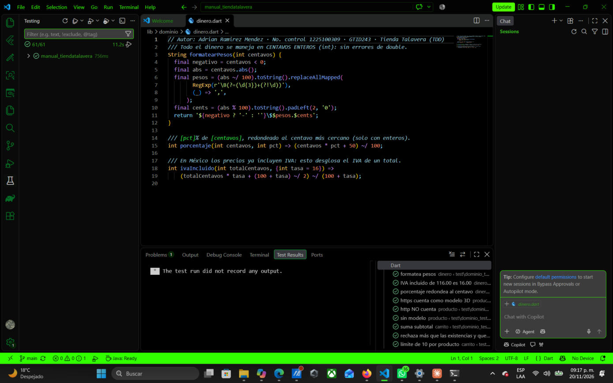
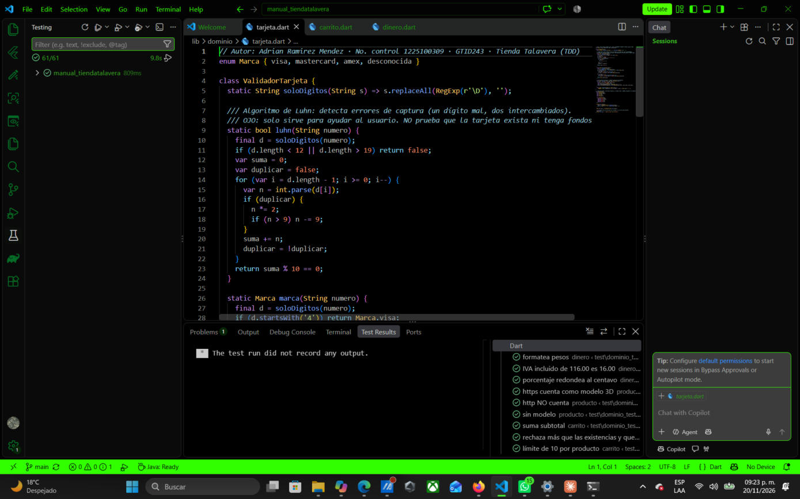

# 🏺 Tienda Talavera — Artesanías de Dolores Hidalgo con TDD

Tienda en Flutter hecha con **TDD** para vender artesanías de Dolores Hidalgo (talavera, dulces, textiles y decoración). Tiene catálogo, carrito, pago con tarjeta **simulado**, cuentas de usuario y un botón **"Ver en tu espacio"** que muestra la pieza en 3D o en realidad aumentada.

- **Materia:** Desarrollo Móvil Integral · UTNG
- **Profesor:** Anastacio Rodríguez García
- **Alumno:** Adrian Ramirez Mendez · No. de control 1225100309 · Grupo GTID243

> ⚠️ La pasarela de pagos y el servidor de cuentas son **simulados**: nunca se cobra dinero real.

---

## 📋 ¿Qué se hizo? (resumen por ronda)

| Ronda | Qué se construyó | Archivo(s) |
|---|---|---|
| 1 | Proyecto, paquetes (`model_viewer_plus`, `shared_preferences`, `flutter_secure_storage`, `crypto`) y permiso de internet | `pubspec.yaml`, `AndroidManifest.xml` |
| 2 | Dinero en **centavos enteros** (nunca `double`) y producto con modelo 3D solo por https | `dinero.dart`, `producto.dart` |
| 3 | Excepciones con nombre propio y **carrito**: existencias, máximo 10 por producto, cupón y envío gratis desde $800 | `excepciones.dart`, `carrito.dart` |
| 4 | Validaciones (correo, contraseña, CP, teléfono), dirección, usuario y orden | `validadores.dart`, `direccion.dart`, `usuario.dart`, `orden.dart` |
| 5 | Tarjeta: algoritmo de **Luhn**, marcas, vigencia, CVV y nunca mostrar el número completo (PCI) | `tarjeta.dart` |
| 6 | Contratos y **pasarela simulada con idempotencia** (misma clave = un solo cobro) | `contratos.dart`, `pasarela_simulada.dart` |
| 7 | **Checkout**: revalida precios y existencias contra el catálogo ANTES de cobrar | `servicio_checkout.dart` |
| 8 | Cuentas: contraseña con hash, **bloqueo tras 5 intentos**, sesión y perfil | `bloqueo_intentos.dart`, `auth_simulada.dart`, `almacenes.dart`, `catalogo_memoria.dart` |
| 9 | **ViewModels** de catálogo, carrito, sesión y checkout (doble toque ignorado) | `presentacion/vm/` |
| 10 | Raíz de composición y pantallas | `dependencias.dart`, `main.dart`, `presentacion/pantallas/` |
| 11 | "Ver en tu espacio": visor 3D y realidad aumentada | `pantalla_ver_en_tu_espacio.dart` |
| 12 | De la simulación a producción (Stripe, Mercado Pago o Conekta) | — |

### Ciclo TDD
🔴 **ROJO:** se escribe la prueba primero (falla) → 🟢 **VERDE:** código mínimo para que pase → 🔵 **REFACTOR:** ordenar sin romper nada.

### Pruebas: 61 en verde
| Archivo | Qué prueba |
|---|---|
| `test/dominio_test.dart` | dinero, producto, carrito, validadores y tarjeta |
| `test/servicios_test.dart` | pasarela, checkout, bloqueo de intentos y cuentas |
| `test/viewmodels_test.dart` | catálogo, carrito, sesión y checkout |

### Estructura
```
lib/
  dominio/        <- reglas del negocio (Dart puro)
  datos/          <- pasarela, cuentas, almacenes y catálogo simulados
  presentacion/   <- ViewModels y pantallas
  dependencias.dart
  main.dart
test/             <- 61 pruebas
```

---

## 📸 Evidencias TDD

### Ronda 2 · Dinero
🔴 **Rojo (terminal, `flutter test test/dominio_test.dart`):** `porcentaje()` sin `+ 50` trunca en lugar de redondear. Espera 1000 y sale 999.


🟢 **Verde:** con `(centavos * pct + 50) ~/ 100` redondea al centavo. 61/61.


### Ronda 3 · Carrito
🔴 **Rojo:** con `>` en vez de `>=`, una compra de $800 justos todavía paga envío (espera 0, sale 9900).


🟢 **Verde:** con `>=` el envío es gratis desde $800. 61/61.


### Ronda 5 · Tarjeta (Luhn)
🔴 **Rojo:** sin `if (n > 9) n -= 9;` el algoritmo de Luhn marca como inválidas tarjetas buenas.


🟢 **Verde:** con la resta de 9 vuelve a validar bien. 61/61.


---

## ▶️ Cómo ejecutarlo
```bash
flutter pub get
flutter test
flutter run
flutter build apk --release
```
En Windows hay que activar el **Modo de desarrollador** (lo pide para los plugins).
El visor 3D se ve en el emulador; la realidad aumentada solo funciona en un teléfono con ARCore.

**Tarjetas de prueba:** `4242 4242 4242 4242` se aprueba · `4000 0000 0000 0002` se rechaza · `4000 0000 0000 9995` fondos insuficientes.

## 🔒 Seguridad
- El dinero siempre en centavos enteros.
- El carrito guardado solo tiene id y cantidad: los precios siempre vienen del catálogo.
- El número de tarjeta nunca se guarda ni se muestra completo.
- La contraseña se guarda con hash y la cuenta se bloquea tras 5 intentos fallidos.
- El token de sesión va en almacenamiento seguro.
