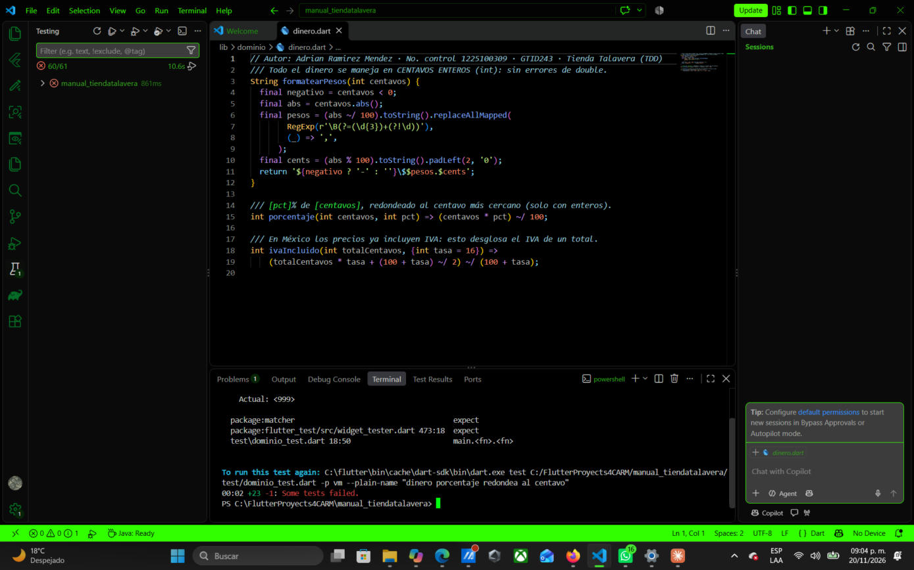
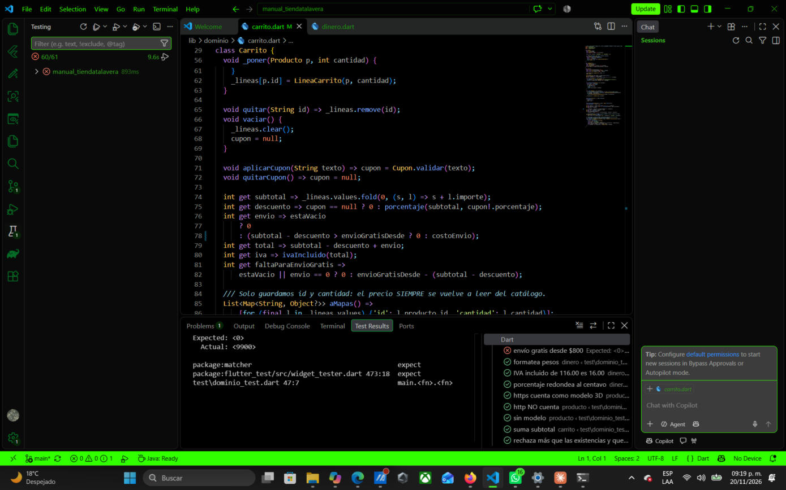
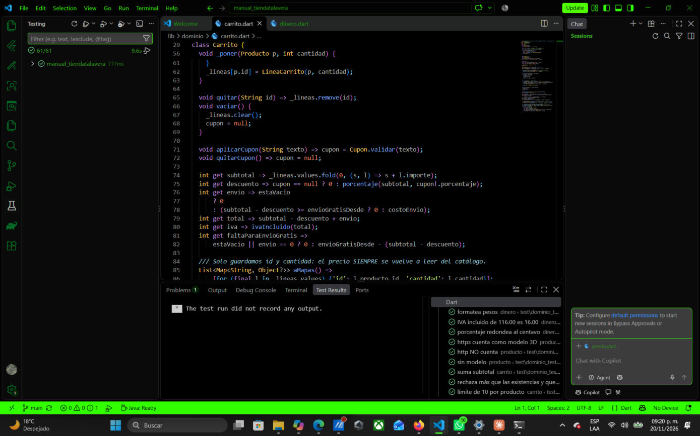
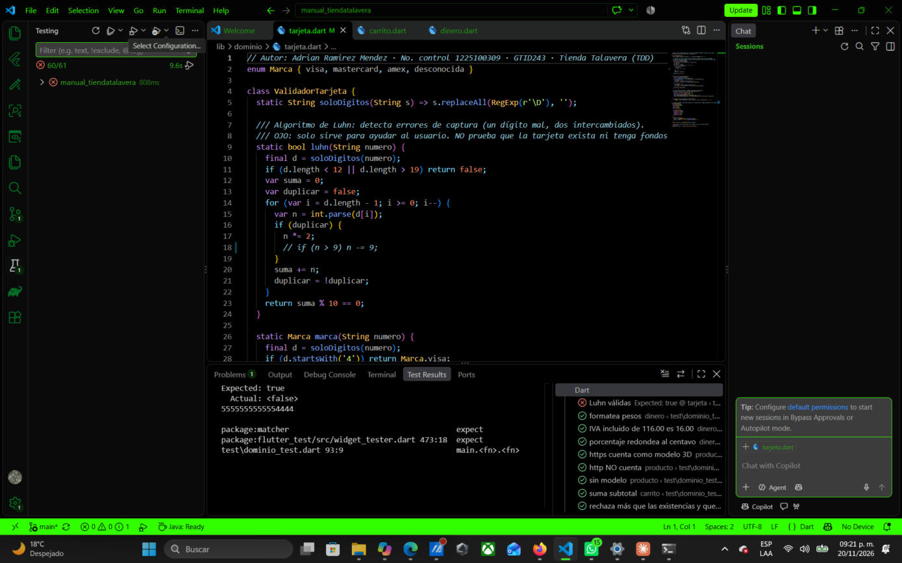

#  Tienda Talavera — Artesanías de Dolores Hidalgo 

---


###  
 **Rojo (terminal, `flutter test test/dominio_test.dart`):** `porcentaje()` sin `+ 50` trunca en lugar de redondear. Espera 1000 y sale 999.


con `(centavos * pct + 50) ~/ 100` redondea al centavo. 61/61.


### 


 con `>=` el envío es gratis desde $800. 61/61.



 `if (n > 9) n -= 9;` el algoritmo de Luhn marca como inválidas tarjetas buenas.


con la resta de 9 vuelve a validar bien. 61/61.


---


flutter pub get
flutter test
flutter run
flutter build apk --release
```
En Windows hay que activar el **Modo de desarrollador** (lo pide para los plugins).
El visor 3D se ve en el emulador; la realidad aumentada solo funciona en un teléfono con ARCore.


